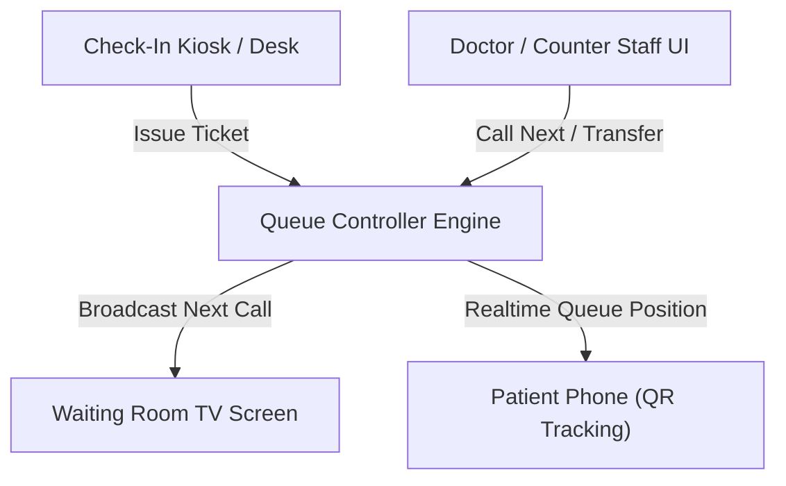

# Pametni Sistem Čakalnice

Smart queue management system for clinics and public counters with waiting room displays, counter controls, and patient QR status.


## Overview

**Pametni Sistem Čakalnice** is a digital queue management application engineered for healthcare clinics, dental offices, and administrative service counters. It streamlines patient check-in, ticket assignment, live waiting room monitor displays with audio alerts, counter staff calling controls, and real-time mobile queue tracking via QR codes.

## Key Features

* **Public Waiting Room TV Display**: Clean display board showing active ticket numbers, counter assignments, and audible call notifications.
* **Service Counter Dashboard**: Desk interface for staff to call next patient, recall numbers, transfer queues, or mark completion.
* **Patient Mobile Status (QR Code)**: Allows waiting patients to scan a ticket QR code and track their queue position from their phone.
* **Multi-Queue Routing**: Supports separate queues for general check-up, laboratory, urgent care, and specialized appointments.
* **Queue Analytics**: Track average wait times, patient throughput, and peak hour distributions.

## Tech Stack

* **Frontend**: React 18, TypeScript, Vite
* **UI & Styling**: Tailwind CSS, Lucide React
* **Realtime Communication**: WebSockets / Event-Driven State Architecture
* **Testing & Tools**: Vitest, Playwright

## System Architecture



## Getting Started

### Prerequisites
* Node.js 18+
* npm

### Installation

1. Clone the repository:
   ```bash
   git clone https://github.com/flegardev/Pametni-sistem-cakalnice.git
   cd pametni-sistem-cakalnice
   ```

2. Install dependencies:
   ```bash
   npm install
   ```

3. Start the development server:
   ```bash
   npm run dev
   ```

## Development Commands

```bash
npm run dev         # Run Vite dev server
npm run build       # Build production application
npm run lint        # Run ESLint
npm test            # Run unit tests
```

## License

This project is open-source software.
